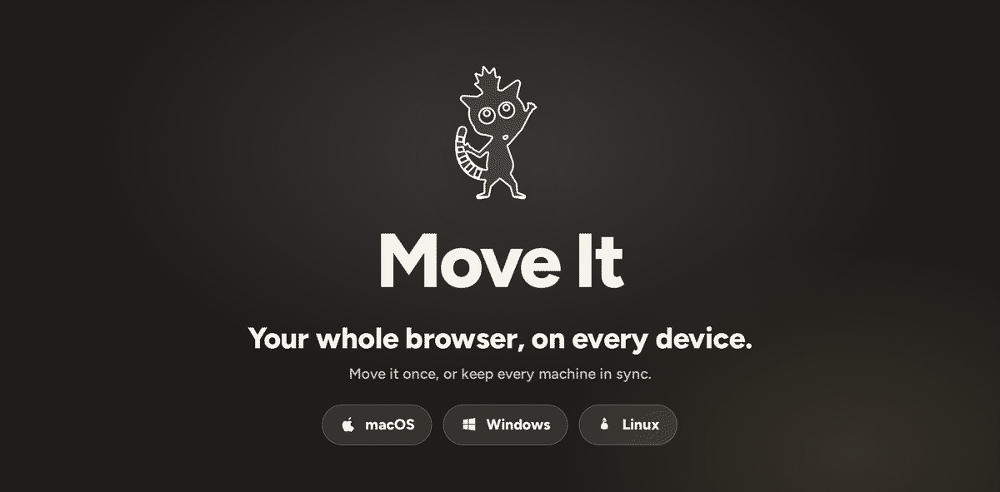
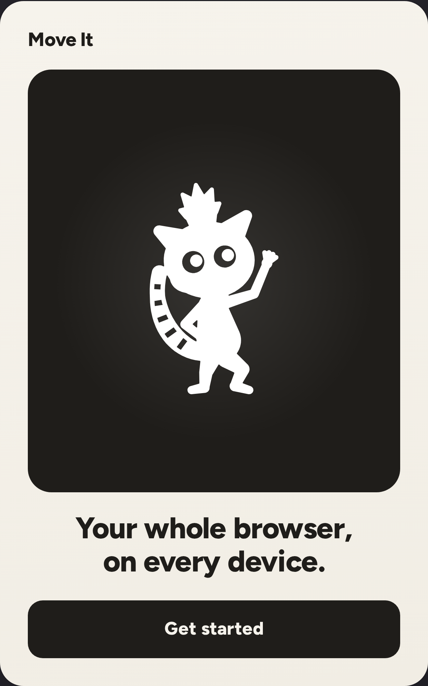
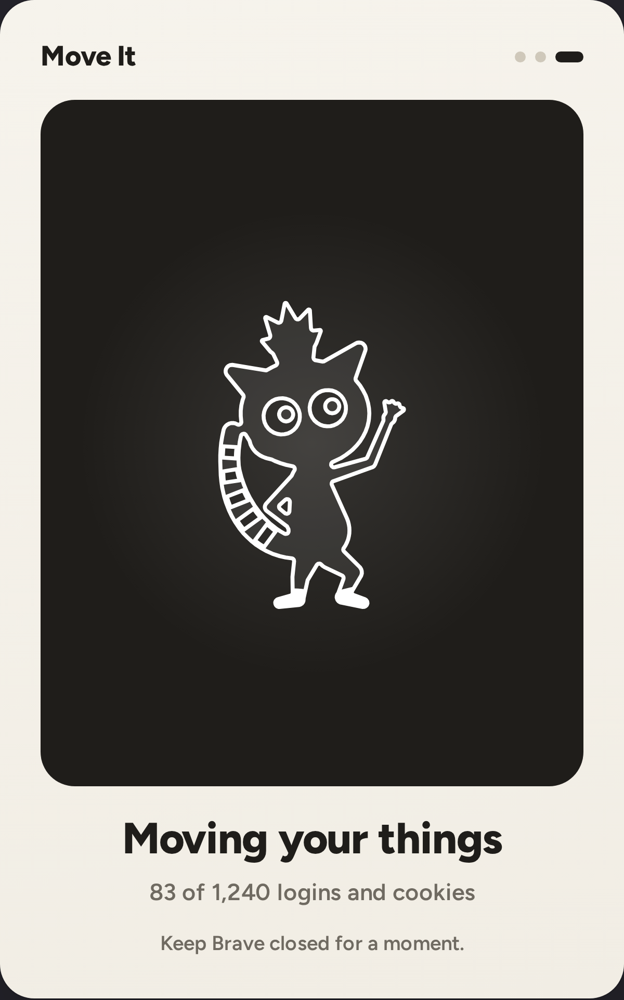
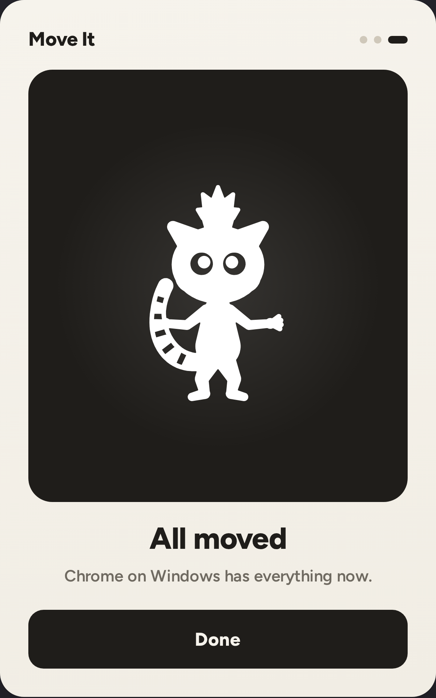

  

&nbsp;&nbsp;

 

I dual boot and I use more than one computer, and my browser never came with me. Every switch meant logging in to everything again and setting my extensions up from zero. So I built Move It.

Move It transfers supported browser data between your devices: cookies, saved passwords, bookmarks, history, and extension state. Some protected data cannot move, and some sites ask you to sign in again. Preview shows what is available and the move report lists skips. The desktop app is being prepared for its first release.

## What comes with you

<table>
<tr>
<td align="center" width="20%"> <b>Logins and cookies</b></td>
<td align="center" width="20%"> <b>Saved passwords</b></td>
<td align="center" width="20%"> <b>Extensions</b> and their settings</td>
<td align="center" width="20%"> <b>Bookmarks</b></td>
<td align="center" width="20%"> <b>History</b></td>
</tr>
</table>

## How it works

<table>
<tr>
<td align="center" width="33%"> <b>1. Pair</b> One device shows a short code. Type it on the other. Nothing to save, nothing to remember.</td>
<td align="center" width="33%"> <b>2. Pick a home for the sealed box</b> A folder you already have: Google Drive, Dropbox, iCloud, or a git repo. Only your devices can open it.</td>
<td align="center" width="33%"> <b>3. Move It</b> See what is about to move, press one button, watch the lemur fill up.</td>
</tr>
</table>

 &nbsp;Move It journals browser changes for recovery and keeps an undo point for the latest move. Review the report before reopening your browsers.

## Ways to use it

<table>
<tr>
<td width="33%"> <b>Move once</b> New laptop, new machine, Linux to Windows. Pair the two and move the supported data in one go.</td>
<td width="33%"> <b>Keep in sync</b> Run another move to merge newer data. Automatic sign-in and sign-out scheduling is not part of the first release.</td>
<td width="33%"> <b>Switch browsers</b> Already on the machine you want? Move straight from one browser to another, Brave to Chrome, no pairing.</td>
</tr>
</table>

## See it move

&nbsp;

&nbsp;

## Browsers

The engine targets Chromium-family profiles. These are implementation and
verification states, not a promise that every login or extension will survive.
The current release candidate still needs fresh-profile real-browser readback
on each supported operating system.

| Browser | Linux | Windows | macOS |
|---|---|---|---|
| Brave | v10/v11 implemented; release readback pending | DPAPI v10 implemented; release readback pending | Keychain v10/v11 implemented; release readback pending |
| Chrome | v10/v11 implemented; release readback pending | DPAPI v10 implemented; App-Bound v20 skipped | Keychain v10/v11 implemented; release readback pending |
| Edge | Profile discovery and v10/v11 implemented; release readback pending | DPAPI v10 implemented; App-Bound v20 skipped | Keychain support implemented; release readback pending |
| Chromium | v10/v11 implemented; release readback pending | DPAPI v10 implemented; release readback pending | Keychain v10/v11 implemented; release readback pending |
| Firefox | Not supported | Not supported | Not supported |

- App-Bound (`v20`) cookies and saved passwords are skipped wherever found,
  including Brave or Chromium builds that enable it. Other supported data can
  still move; Move It does not bypass App-Bound protection.
- A fresh Linux v11 store accepts a key retrieved from that browser's unlocked
  v2 keyring item. A missing item can use the browser's v10 fallback; a locked or
  unavailable keyring fails closed. Never-launched profiles still need live proof.
- Unit and fixture tests verify engine behavior, not acceptance by a real
  browser. Session validity, extension compatibility, and cross-OS readback
  need separate verification.
- Firefox profiles, passkeys, and device-bound credentials are not transferred.
  See [SECURITY.md](SECURITY.md) for encryption, pairing, and local-backup limits.

<b>Under the hood</b>

 

- Rust core, one self-contained binary per platform. Tauri shell with a small web UI (`design/`).
- Pairing creates a random 256-bit secret that lives in the OS keychain. You never see or type it.
- The sealed box is one file with authenticated encryption (AES-256-GCM) and a fresh nonce every time. Payload contents are encrypted; filenames, sizes, timing, and pairing metadata remain visible.
- Each device reads its own browser locally with that system's native scheme (DPAPI on Windows, the v10 and v11 store on Linux) and re-encrypts on import with the target's own scheme.
- Per cookie, the newest wins, and both sides merge instead of overwriting.
- The browser must be closed for every write, there is a backup before each one, and unreadable or protected data is reported as skipped or blocks the move.

## Desktop downloads

Install Move It only from the
[official GitHub Releases page](https://github.com/0xovo/move-it/releases).
Each release ships a `SHA256SUMS` file listing the SHA256 digest of every asset.
Verify your download before opening the installer (`sha256sum -c SHA256SUMS
--ignore-missing` on Linux, or compare with `Get-FileHash` on Windows). In-app
updates verify signed packages; checksums are an extra check for manual downloads.
See [SECURITY.md](SECURITY.md) for reporting issues and why third-party mirrors
are unsafe.

## Support

Move It is free. If it saved you a weekend of logging back in, a coffee keeps it going. Updates land on X first.

&nbsp;&nbsp;

## License

[GPL-3.0](LICENSE). Use it, change it, share it. If you ship a changed version, you share its source too.

The Move It name, the lemur and the logo are not covered by the license. Forks need their own name and art.

Icons, including the coffee and X buttons, are Move It's own. Type: [Figtree](https://github.com/erikdkennedy/figtree) (OFL). Google Drive and Dropbox marks from [Phosphor](https://phosphoricons.com) (MIT). QR codes by [qrcode-generator](https://github.com/kazuhikoarase/qrcode-generator) (MIT).
