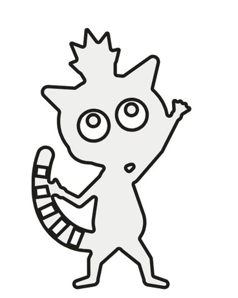
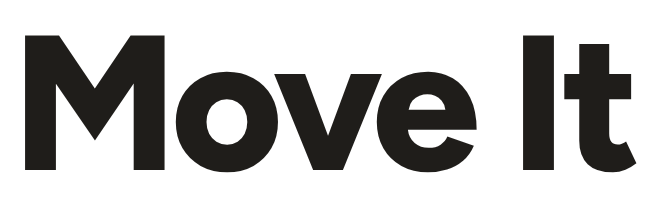

<picture>
  <source media="(prefers-color-scheme: dark)" srcset="docs/img/lemur-dark.png">
  
</picture>
 
<picture>
  <source media="(prefers-color-scheme: dark)" srcset="docs/img/wordmark-dark.png">
  
</picture>

**Your whole browser, on every device.**

&nbsp;&nbsp;

 

I dual boot and I use more than one computer, and my browser never came with me. Every switch meant logging in to everything again and setting my extensions up from zero. So I built Move It.

It picks up your whole browser and sets it down on your other device. You stay logged in, your extensions keep their settings, and your bookmarks and history follow. The lemur fills up as your stuff moves, and when he is full, you are done.

## What comes with you

<table>
<tr>
<td align="center" width="20%"> <b>Logins and cookies</b></td>
<td align="center" width="20%"> <b>Saved passwords</b></td>
<td align="center" width="20%"> <b>Extensions</b> and their settings</td>
<td align="center" width="20%"> <b>Bookmarks</b></td>
<td align="center" width="20%"> <b>History</b></td>
</tr>
</table>

## How it works

<table>
<tr>
<td align="center" width="33%"> <b>1. Pair</b> One device shows a short code. Type it on the other. Nothing to save, nothing to remember.</td>
<td align="center" width="33%"> <b>2. Pick a home for the sealed box</b> A folder you already have: Google Drive, Dropbox, iCloud, or a git repo. Only your devices can open it.</td>
<td align="center" width="33%"> <b>3. Move It</b> See what is about to move, press one button, watch the lemur fill up.</td>
</tr>
</table>

 &nbsp;Nothing gets deleted. Move It backs up before every change, and one button undoes the last sync.

## Two ways to use it

<table>
<tr>
<td width="50%"> <b>Move once</b> New laptop, new browser, Brave to Chrome, Linux to Windows. Everything comes over in one go.</td>
<td width="50%"> <b>Keep in sync</b> Runs quietly when you sign in and out, so every machine is simply the same browser.</td>
</tr>
</table>

## Browsers

| | Windows | Linux | macOS |
|---|---|---|---|
| Brave | Works | Works | Not yet |
| Chrome | Testing | Works | Not yet |
| Edge | Testing | Not yet | Not yet |
| Chromium | Testing | Works | Not yet |
| Firefox | Later | Later | Later |

"Works" means proven against the real browser with a real login. A few strict sites tie a login to your device, so they may ask you to sign in once more.

<b>Under the hood</b>

 

- Rust core, one self-contained binary per platform. Tauri shell with a small web UI (`design/`).
- Pairing creates a random 256-bit secret that lives in the OS keychain. You never see or type it.
- The sealed box is one file with authenticated encryption (AES-256-GCM or XChaCha20-Poly1305) and a fresh nonce every time. Your storage provider only ever holds ciphertext.
- Each device reads its own browser locally with that system's native scheme (DPAPI on Windows, the v10 and v11 store on Linux) and re-encrypts on import with the target's own scheme.
- Per cookie, the newest wins, and both sides merge instead of overwriting.
- The browser must be closed for every write, there is a backup before each one, and anything the engine cannot fully read is left alone.

## Support

Move It is free. If it saved you a weekend of logging back in, a coffee keeps it going. Updates land on X first.

&nbsp;&nbsp;

## License

[GPL-3.0](LICENSE). Use it, change it, share it. If you ship a changed version, you share its source too.

The Move It name, the lemur and the logo are not covered by the license. Forks need their own name and art.

Icons, including the coffee and X buttons, are Move It's own. Type: [Figtree](https://github.com/erikdkennedy/figtree) (OFL). Google Drive and Dropbox marks from [Phosphor](https://phosphoricons.com) (MIT). QR codes by [qrcode-generator](https://github.com/kazuhikoarase/qrcode-generator) (MIT).
